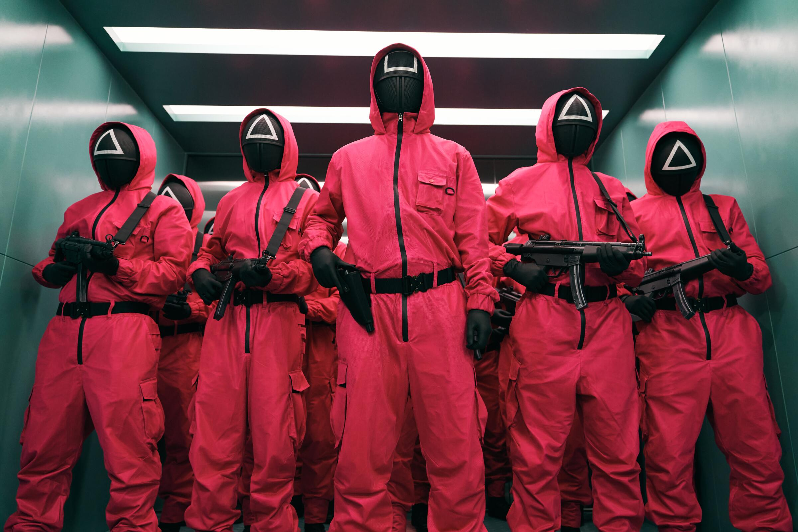
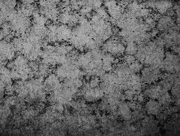
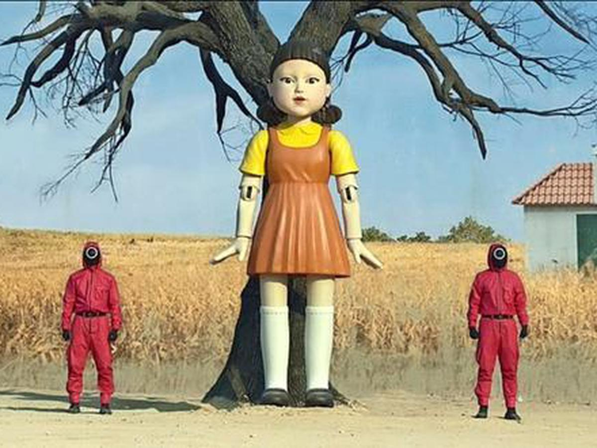

# AutomataArcade

Juego desarrollado en C++ con SFML, enfocado en un modo competitivo de dos jugadores con niveles, preguntas, lógica de puntuación y persistencia de resultados en una base de datos PostgreSQL de Neon.

## Descripción general

AutomataArcade es un proyecto de programación en C++ para macOS que combina:

- interfaz gráfica con SFML
- lógica de juego por niveles
- manejo de estados del juego (menú, explicación, nivel, final)
- tablero isométrico y preguntas de respuesta binaria
- puntaje y leaderboard
- integración con Neon PostgreSQL para guardar resultados

El proyecto se ha desarrollado pensando en una experiencia arcade tipo arena de decisiones, donde cada jugador debe responder preguntas, avanzar en un recorrido y competir por lograr la mayor puntuación posible.

## Arquitectura del proyecto

El sistema está organizado en capas funcionales y de presentación:

### 1. Motor del juego
Archivo principal: `GameEngine.cpp` / `GameEngine.h`

`GameEngine` es el núcleo del programa. Se encarga de:

- crear y administrar la ventana de SFML
- controlar los estados del juego
- manejar la entrada del usuario
- reproducir audio
- cargar fondos y textos del menú
- inicializar la base de datos
- consultar y refrescar el ranking
- finalizar partida y pasar a la pantalla final

Los estados del juego definidos en `Common.h` son:

- `MAIN_MENU`
- `EXPLANATION_SCREEN`
- `LEVEL_1`, `LEVEL_2`, `LEVEL_3`, `LEVEL_4`
- `FINAL_SCORE`

### 2. Lógica por niveles
Archivo principal: `Level.h` / `LevelIsometric.h` / `LevelIsometric.cpp`

La lógica del juego se encapsula en la clase abstracta `Level`, mientras que `LevelIsometric` implementa la mecánica del nivel isométrico. Aquí se resuelven aspectos como:

- generación del escenario
- carga de preguntas y textos
- actualización del estado del nivel
- detección de respuestas correctas o incorrectas
- movimiento de los avatares
- avance por filas o puentes
- cálculo del puntaje final
- control de fin de nivel

La estructura del proyecto hace que cada nivel pueda reutilizar la misma base de comportamiento, con reglas específicas según el tipo de escenario.

### 3. Persistencia de puntajes
Archivo principal: `Database.h` / `Database.cpp`

La base de datos se abstrae en la clase `Database`, que permite:

- conectar a PostgreSQL usando libpq
- insertar resultados de jugadores
- consultar los mejores puntajes
- cerrar la conexión de forma segura

Se usa Neon como proveedor de PostgreSQL, y la tabla principal esperada es `public.jugadores` con columnas como:

- `id`
- `nombre`
- `puntaje`
- `fecha`

### 4. Recursos visuales y assets
Carpeta: `sources/`

Los recursos del proyecto se encuentran en la carpeta `sources/` y incluyen fondos, texturas y audio:

- `fondomenu.jpeg` -> fondo del menú principal
- `fotomenufinal.jpeg` -> fondo de la pantalla final
- `pisonivel4.jpeg` -> superficie de nivel
- `parednivel4.jpg` / `parednivel4.webp` -> elementos visuales del escenario
- `audiojuego.mp3` -> música del juego

## Flujo principal del juego

1. El usuario ingresa el nombre de los dos jugadores en el menú principal.
2. Se muestra la pantalla de instrucciones/descripción del nivel.
3. Se inicia el juego en el nivel principal.
4. Los jugadores avanzan y responden preguntas según la lógica del nivel.
5. Al terminar la partida, el sistema guarda los puntajes en Neon.
6. Se actualiza el leaderboard y se muestra la pantalla final con el ganador.
7. Se puede reiniciar y volver al menú.

## Capturas / referencias visuales del juego

### Menú principal



El menú principal presenta la pantalla inicial del juego con los nombres de los jugadores, la opción de comenzar y el leaderboard.

### Pantalla de instrucciones

La pantalla de descripción se genera dinámicamente por código en `GameEngine::renderExplanationScreen()`. Es la vista previa de reglas y controles antes de empezar la partida. No tiene un archivo estático independiente, pero forma parte del flujo obligatorio del juego.

### Nivel del juego



La escena del nivel usa un estilo isométrico, con preguntas, tiles, movimiento y lógica de respuesta para cada jugador.

### Pantalla final



La pantalla final muestra los puntajes, el ganador o empate, y permite reiniciar el sistema para volver al menú principal.

## Estructura de archivos

```text
lenguaje3/
├── CMakeLists.txt
├── Common.h
├── Database.h
├── Database.cpp
├── GameEngine.h
├── GameEngine.cpp
├── Level.h
├── LevelIsometric.h
├── LevelIsometric.cpp
├── main.cpp
├── README.md
├── RobloxAvatar.h
├── IsoRenderer.h
├── sources/
│   ├── audiojuego.mp3
│   ├── fondomenu.jpeg
│   ├── fotomenufinal.jpeg
│   ├── parednivel4.jpg
│   ├── parednivel4.webp
│   ├── pisonivel4.jpeg
│   └── ...
├── build/
└── ...
```

## Requisitos

- macOS
- Xcode Command Line Tools
- Homebrew
- CMake
- SFML 3
- PostgreSQL client library (`libpq`)

## Cómo ejecutar el proyecto en macOS

1. Abrir una terminal en la raíz del proyecto.
2. Instalar la dependencia de PostgreSQL:

```bash
brew install libpq
```

3. Configurar CMake apuntando a la librería de postgres instalada por Homebrew:

```bash
cmake -S . -B build \
  -DPostgreSQL_INCLUDE_DIR="$(brew --prefix libpq)/include" \
  -DPostgreSQL_LIBRARY="$(brew --prefix libpq)/lib/libpq.dylib"
```

4. Compilar:

```bash
cmake --build build --parallel 2
```

5. Ejecutar la aplicación:

```bash
./build/AutomataArcade
```

## Nota importante sobre macOS

Este proyecto fue desarrollado y probado en un entorno macOS con Homebrew. Por esa razón, la configuración de PostgreSQL se realiza con `libpq` desde Homebrew y no con una instalación genérica de Linux o Windows. La apariencia y la ejecución de la ventana se basan en SFML 3, que está preparado para funcionar de forma nativa en macOS.

## Base de datos Neon

La persistencia del ranking se realiza con PostgreSQL en Neon. La lógica del programa intenta conectarse a la base de datos al arrancar y, al terminar una partida, guarda el nombre y el puntaje de cada jugador. Luego recupera los mejores registros para mostrarlos en la pantalla de inicio.

## Observaciones finales

- El proyecto compila correctamente con la configuración adecuada de PostgreSQL.
- El juego muestra y guarda resultados en la base de datos.
- La fuente `sources/arial.ttf` no está presente en el proyecto, por eso se emite un aviso de carga, pero la aplicación sigue funcionando con fuentes del sistema.
- Se recomienda no subir credenciales reales de Neon al repositorio; lo ideal es usar variables de entorno o archivos de configuración local no versionados.

## Créditos y propósito

Este proyecto fue desarrollado como una práctica de programación en C++, integrando conceptos de:

- programación orientada a objetos
- interfaces gráficas con SFML
- lógica de videojuegos
- manejo de estados
- persistencia de datos
- trabajo con bases de datos relacionales

Su objetivo es reforzar la construcción de un juego completo, con una estructura clara y con integración real de almacenamiento y ranking.

