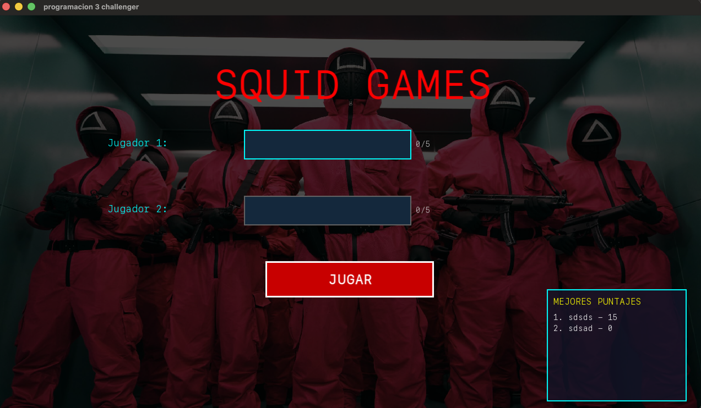
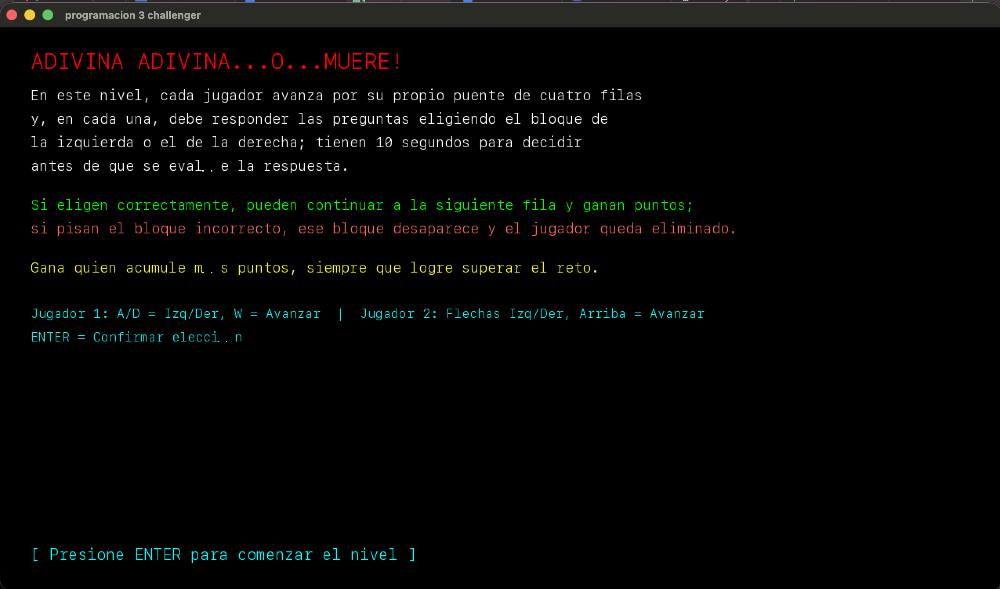
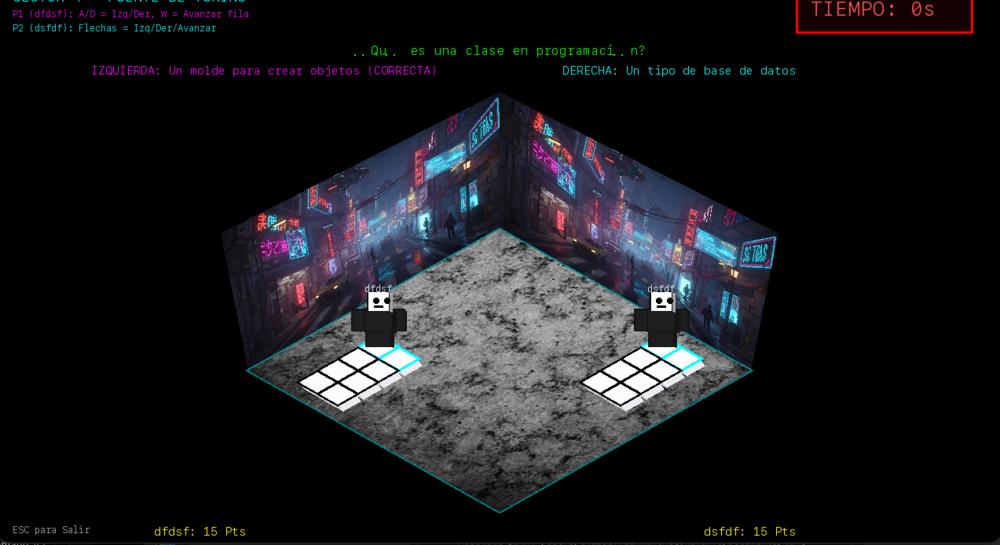
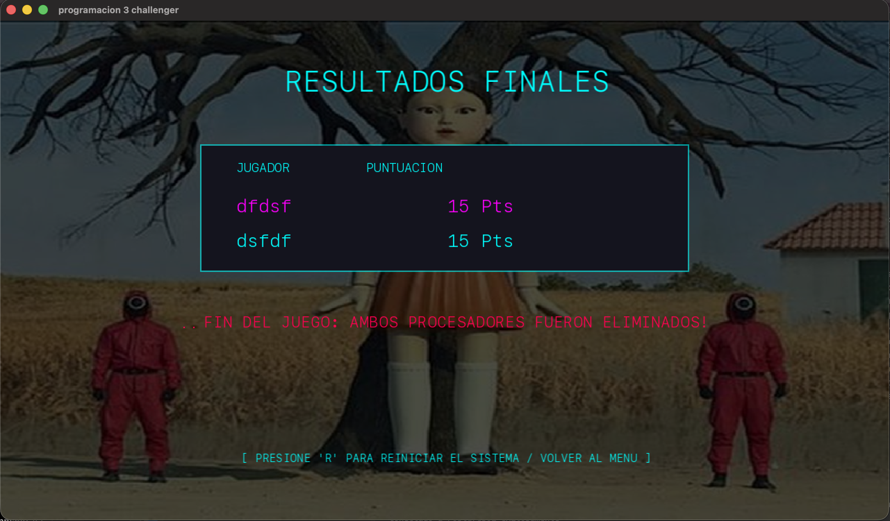

# Lenguaje 3 Challenger

Lenguaje 3 Challenger es un videojuego arcade para dos jugadores desarrollado en C++ con SFML. La partida consiste en superar un nivel de preguntas y decisiones: cada jugador elige respuestas mientras avanza por un puente, y al finalizar se muestran los puntajes y el ganador. Los resultados se guardan en una base de datos PostgreSQL alojada en Neon y se consultan para mostrar el ranking.

El proyecto se desarrolla y se ejecuta en **macOS**.

## Capturas del juego

Las imágenes siguientes son capturas de las pantallas del programa y se muestran en el orden en que aparecen durante la partida.

### 1. Menú principal



Pantalla de inicio. Permite ingresar el nombre de ambos jugadores, consultar el ranking y comenzar la partida.

### 2. Descripción e instrucciones



Antes de jugar aparece una pantalla con la explicación de las reglas y los controles.

### 3. Nivel del juego



Esta es la pantalla de juego. Los dos jugadores participan en el mismo nivel y utilizan sus controles para escoger una respuesta y avanzar por el puente.

### 4. Puntajes finales



Al finalizar la partida se presentan los puntajes de ambos jugadores y el resultado. Desde esta pantalla se puede volver al menú e iniciar otra partida.

## Arquitectura

El programa separa el ciclo principal del juego, la lógica del nivel y las operaciones de persistencia.

### Motor y flujo de pantallas

`main.cpp` crea e inicializa `GameEngine`. `GameEngine` administra la ventana de SFML, recibe la entrada, actualiza y dibuja la pantalla activa, y controla el cambio entre el menú, las instrucciones, el nivel único y los resultados finales. También gestiona los recursos visuales y el audio.

El contexto compartido de jugadores, puntajes y estado está definido en `Common.h`. La secuencia de pantallas es:

1. `MAIN_MENU`: ingreso de nombres y consulta del ranking.
2. `EXPLANATION_SCREEN`: descripción de reglas y controles.
3. `LEVEL_4`: ejecución del único nivel jugable del proyecto.
4. `FINAL_SCORE`: presentación de puntajes y opción de volver al menú.

El identificador `LEVEL_4` es el nombre interno utilizado actualmente por el código; el juego ofrece **un solo nivel jugable**, no cuatro niveles.

### Nivel y reglas de juego

`Level.h` define la interfaz común de un nivel (`init`, `update`, `draw` e `isFinished`). `LevelIsometric.h` y `LevelIsometric.cpp` implementan el nivel jugable: la escena, las preguntas, el puente de cuatro filas, los movimientos de los jugadores, la evaluación de respuestas y la finalización de la partida. `RobloxAvatar.h` contiene el avatar empleado por los jugadores y `IsoRenderer.h` reúne funciones de dibujo de elementos isométricos.

Los controles que se muestran en las instrucciones son:

- Jugador 1: `A` y `D` para elegir izquierda o derecha; `W` para avanzar.
- Jugador 2: flechas izquierda y derecha para elegir; flecha arriba para avanzar.
- `Enter`: confirmar el inicio desde el menú y comenzar después de la pantalla de instrucciones.
- `Tab`: cambiar entre los campos de nombre en el menú.
- `R`: regresar al menú desde los resultados finales.
- `Esc`: salir del juego.

### Persistencia y ranking

`Database.h` y `Database.cpp` encapsulan la conexión a PostgreSQL mediante `libpq`. El motor consulta los tres mejores puntajes al iniciar y vuelve a consultar el ranking después de guardar los resultados de ambos jugadores al finalizar la partida.

La tabla utilizada por el programa es `public.jugadores`, con las columnas `nombre` y `puntaje` empleadas por las consultas. La base está alojada en Neon.

**Seguridad:** no publiques la cadena de conexión ni credenciales de Neon en el repositorio. Antes de compartir el proyecto, configura las credenciales fuera del código fuente y rota la contraseña si alguna credencial real ya fue incluida en un commit.

## Estructura principal

```text
lenguaje3/
├── CMakeLists.txt          # Configuración de compilación con CMake
├── Common.h                # Estados y datos compartidos del juego
├── Database.h              # Interfaz de acceso a PostgreSQL
├── Database.cpp            # Conexión, guardado y consulta del ranking
├── GameEngine.h             # Declaración del motor del juego
├── GameEngine.cpp           # Ciclo del juego, pantallas y entradas
├── Level.h                  # Interfaz base para un nivel
├── LevelIsometric.h         # Declaración del nivel jugable
├── LevelIsometric.cpp       # Reglas y dibujo del nivel
├── RobloxAvatar.h           # Representación de los jugadores
├── IsoRenderer.h            # Funciones de dibujo isométrico
├── main.cpp                 # Punto de entrada
├── README.md
└── sources/
    ├── fotomenu.png         # Captura: menú principal
    ├── descripcion.png      # Captura: instrucciones
    ├── nivel.png            # Captura: nivel jugable
    ├── final.png            # Captura: resultados finales
    ├── audiojuego.mp3
    ├── fondomenu.jpeg
    ├── fotomenufinal.jpeg
    ├── parednivel4.jpg
    ├── parednivel4.webp
    └── pisonivel4.jpeg
```

## Requisitos

- macOS
- Xcode Command Line Tools
- Homebrew
- CMake
- SFML 3
- PostgreSQL `libpq`
- Acceso a la base Neon configurada para la aplicación

Instala las dependencias con Homebrew si aún no están disponibles:

```bash
brew install cmake sfml libpq
```

## Compilar y ejecutar en macOS

Ejecuta estos comandos desde la carpeta raíz del proyecto:

```bash
cmake -S . -B build \
  -DPostgreSQL_INCLUDE_DIR="$(brew --prefix libpq)/include" \
  -DPostgreSQL_LIBRARY="$(brew --prefix libpq)/lib/libpq.dylib"
cmake --build build --parallel 2
./build/AutomataArcade
```

La ruta del ejecutable corresponde al nombre de destino definido en `CMakeLists.txt`. Si CMake no encuentra SFML o `libpq`, confirma que las dependencias estén instaladas con Homebrew y vuelve a ejecutar la configuración de CMake.

## Base de datos

La aplicación espera que exista la tabla `public.jugadores` en Neon. Para comprobar sus columnas desde el SQL Editor de Neon:

```sql
SELECT column_name, data_type, is_nullable, column_default
FROM information_schema.columns
WHERE table_schema = 'public'
  AND table_name = 'jugadores'
ORDER BY ordinal_position;
```

La aplicación inserta los nombres y puntajes de los dos jugadores al concluir el nivel y selecciona los registros ordenados de mayor a menor puntaje para el ranking.

## Notas de ejecución

- El README y las capturas usan rutas relativas al repositorio; conserva la carpeta `sources/` junto a los archivos del proyecto.
- La aplicación puede informar que no encuentra `sources/arial.ttf`. Esa fuente no está incluida; el código intenta cargar fuentes alternativas del sistema.
- El proyecto se ha configurado y probado en macOS con SFML 3 y `libpq` instalados por Homebrew.
